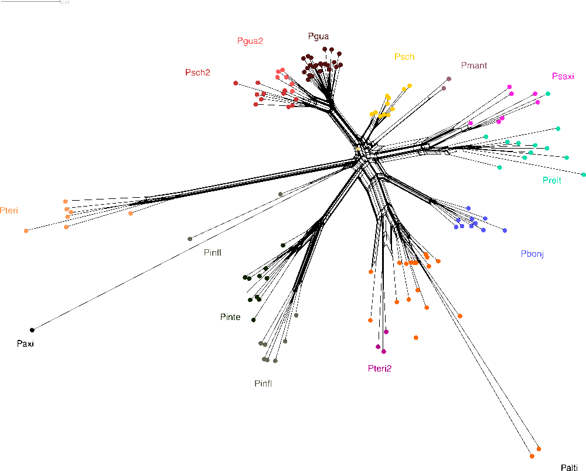

# 01 — SplitsTree: phylogenetic network (NeighborNet)

Draw a **phylogenetic network** of the individuals with the NeighborNet
method in SplitsTree. It is a quick, exploratory first look at the
relationships between individuals and populations, and at the conflicting
signal in the data (e.g. from hybridization or incomplete lineage sorting).

## Install

SplitsTree is a program with a graphical interface: install it on your own
computer.

- **SplitsTree 4** (used in the original analysis):
  <https://software-ab.cs.uni-tuebingen.de/download/splitstree4/welcome.html>
- **SplitsTree CE** (newer version, the same method):
  <https://software-ab.cs.uni-tuebingen.de/download/splitstree6/welcome.html>

To convert the VCF to NEXUS on the server:

```bash
conda create -n phylo vcftools bcftools python=3.11
conda activate phylo
mkdir -p ~/programs && cd ~/programs
git clone https://github.com/edgardomortiz/vcf2phylip.git
```

(or use PGDSpider, see [06_structure](../../06_structure/#22-option-b-pgdspider)).

## Prepare the folder

```
01_splitstree/
├── data/      my_data-out-miss0.9-maf0.01-th100.recode.vcf  (from 03_filtering, with or without outgroup)
│              popmap.txt
└── results/
```

You can draw the network with and without the outgroup: with the outgroup
you see where the root falls; without it, the structure within the ingroup
is easier to see.

---

## 1. Background

A tree forces the data into one branching history. When some characters
support one grouping and others a different one (because of hybridization,
gene flow or incomplete lineage sorting), a tree shows only one of them.

**NeighborNet** builds a network from the genetic distances between
individuals. Where the data are tree-like, it looks like a tree; where
there is conflicting signal, it shows **boxes** (reticulations). The more
boxes between two groups, the more conflicting signal.

> A network shows conflict in the data, **not** its cause: boxes can come
> from hybridization, but also from incomplete lineage sorting or noise.
> Use the introgression tutorials ([05](../05_ancestry_painting/),
> [06](../06_dsuite/)) to test for gene flow.

## 2. Convert the VCF to NEXUS

```bash
conda activate phylo
cd ~/my_project/phylogenomics/01_splitstree
python ~/programs/vcf2phylip/vcf2phylip.py -i data/my_data-out-miss0.9-maf0.01-th100.recode.vcf -p --nexus
```

- `-p`: do not write a PHYLIP file; `--nexus`: write a NEXUS file.
- The output is written **in the folder of the VCF**, with `.min4.nexus` at
  the end.
- Heterozygous genotypes are written as IUPAC codes (R, Y, M, K, S, W) and
  missing data as `N`.

> **NEXUS files from PGDSpider** end with a `BEGIN SETS` block (population
> definitions). SplitsTree does not read it: open the file in a text editor
> and **delete everything after the first `END;`**:
>
> ```
>     ;
> END;               <- keep up to here
> BEGIN SETS;        <- delete from here
>   TaxSet pop_1 = 1-80;
>   ...
> END;
> ```

Copy the NEXUS file to your computer.

## 3. Draw the network

1. Open SplitsTree and open the NEXUS file (**File → Open**).
2. SplitsTree calculates the distances between individuals
   (**uncorrected P**, the proportion of different sites) and draws the
   **NeighborNet** network automatically.
3. To see the support of the splits, run a bootstrap
   (**Analysis → Bootstrap**, e.g. 1000 replicates): the support values
   appear on the edges.

### Make the figure readable

- **Color the individuals by population:** select the labels of a
  population (click and drag, or **Edit → Find**) and change the color of
  the labels and nodes in the format window (**Edit → Format**).
- Replace the sample IDs by population names, or hide the labels, to
  make the groups easier to see.
- **Export** the figure (**File → Export Image**, e.g. SVG or PDF) and
  finish it in Inkscape or Illustrator.

In the original analysis, the network was drawn with all the individuals
and with the outgroup. When duplicated samples were found later, the
network had to be redone without them: check your samples before the
final figures ([03_filtering](../../03_filtering/#3-select-the-samples)).



*Example: NeighborNet of the HIGHLAND data (132 individuals), with the tips coloured and labelled by population after editing.*

## 4. Interpretation

- **Groups** of individuals separated by long edges are genetically
  distinct, like the clusters of the PCA and STRUCTURE
  ([05](../../05_pca_dapc/), [06](../../06_structure/)).
- **Boxes** between groups mean conflicting signal: compare with
  STRUCTURE (admixed individuals?) and test with D statistics
  ([06_dsuite](../06_dsuite/)).
- **Individuals between groups**, connected to both by boxes, are
  candidates for hybrids: check them with ancestry painting
  ([05](../05_ancestry_painting/)).
- Long terminal edges can also come from missing data: check the missing
  data of those individuals.

## Next step

A maximum-likelihood tree: [02_raxml](../02_raxml/).

## More information

- SplitsTree manual and tutorials:
  <https://software-ab.cs.uni-tuebingen.de/download/splitstree4/welcome.html>
- vcf2phylip: <https://github.com/edgardomortiz/vcf2phylip>

## References

- Huson DH, Bryant D (2006) Application of phylogenetic networks in
  evolutionary studies. *Molecular Biology and Evolution* 23: 254–267.
- Bryant D, Moulton V (2004) Neighbor-Net: an agglomerative method for the
  construction of phylogenetic networks. *Molecular Biology and Evolution*
  21: 255–265.
- Ortiz EM (2019) vcf2phylip v2.0: convert a VCF matrix into several matrix
  formats for phylogenetic analysis. Zenodo. doi:10.5281/zenodo.2540861
