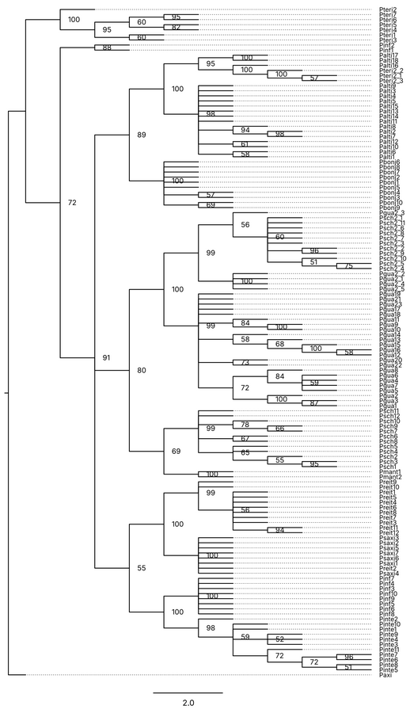

# 02 — RAxML-ng: maximum-likelihood tree

Infer a **maximum-likelihood (ML) tree** of the individuals from the
concatenated SNPs with RAxML-ng, with bootstrap support.

**Script**

| Script | What it does |
|---|---|
| [`scripts/remove_invariant_sites.py`](scripts/remove_invariant_sites.py) | Removes the columns that RAxML-ng considers invariant, needed for the `+ASC_LEWIS` model |

## Install

```bash
conda create -n raxml raxml-ng python=3.11
conda activate raxml
raxml-ng --version
```

For the VCF conversion, `vcf2phylip.py` (see [01_splitstree](../01_splitstree/#install))
or PGDSpider. To look at the trees: [FigTree](https://github.com/rambaut/figtree/releases)
on your computer, or [iTOL](https://itol.embl.de/) online.

## Prepare the folder

```
02_raxml/
├── data/      my_data-out-miss0.9-maf0.01-th100.recode.vcf  (from 03_filtering, with outgroup)
├── scripts/   remove_invariant_sites.py
└── results/
```

---

## 1. Background

RAxML-ng finds the tree that maximises the likelihood of the alignment
under a model of DNA substitution. With SNP data, the alignment has only
**variable sites**: a model that expects invariant sites would overestimate
the branch lengths. The **ascertainment bias correction** (`+ASC_LEWIS`)
corrects for this.

**Bootstrap**: the alignment is resampled many times and a tree is inferred
from each resample. The support of a branch is the percentage of bootstrap
trees that have it.

> **Concatenation and the coalescent.** RAxML-ng treats all SNPs as one
> alignment with one history. With closely related populations, different
> loci can have different histories (incomplete lineage sorting), and a
> concatenated tree can have high support for a wrong topology. Compare it
> with SVDQuartets ([03](../03_svdquartets/)), which uses a coalescent
> model.

## 2. Make the alignment

### 2.1 VCF to PHYLIP

```bash
conda activate raxml
cd ~/my_project/phylogenomics/02_raxml
python ~/programs/vcf2phylip/vcf2phylip.py -i data/my_data-out-miss0.9-maf0.01-th100.recode.vcf
mv data/my_data-out-miss0.9-maf0.01-th100.recode.min4.phy data/my_data.phy
```

(In the original analysis the PHYLIP file was made with PGDSpider; both
work.)

### 2.2 Remove invariant sites

Check the alignment with the model you will use:

```bash
raxml-ng --check --msa data/my_data.phy --model GTR+ASC_LEWIS --prefix results/check
```

If it says:

```
ERROR: You enabled ascertainment bias correction for partition noname, but it contains 229 invariant sites.
```

remove those columns:

```bash
python scripts/remove_invariant_sites.py data/my_data.phy data/my_data.noinv.phy
raxml-ng --check --msa data/my_data.noinv.phy --model GTR+ASC_LEWIS --prefix results/check
```

```
2706 sites in, 229 invariant removed, 2477 kept: data/my_data.noinv.phy
Alignment can be successfully read by RAxML-NG.
```

(Numbers from a test dataset.)

Why are there invariant sites in a SNP alignment? Heterozygotes are written
as IUPAC codes (R = A/G, ...). A column with only A and R is a SNP in the
VCF, but RAxML-ng sees that every individual can carry an A, so it counts
the column as invariant.

## 3. Search for the best tree

```bash
byobu
raxml-ng --msa data/my_data.noinv.phy --model GTR+ASC_LEWIS --prefix results/tree \
    --threads 10 --seed 1234 --tree pars{25},rand{25}
```

- `--model GTR+ASC_LEWIS`: GTR substitution model with ascertainment bias
  correction.
- `--tree pars{25},rand{25}`: 50 independent searches, from 25 parsimony and
  25 random starting trees. The default is 20 (10 + 10).
- `--seed`: random seed, to repeat the analysis.
- `--threads`: number of processors.

```
Final LogLikelihood: -140190.777576
Best ML tree saved to: .../results/tree.raxml.bestTree
All ML trees saved to: .../results/tree.raxml.mlTrees
```

### 3.1 Did the searches find the same tree?

```bash
grep "ML tree search #" results/tree.raxml.log
raxml-ng --rfdist --tree results/tree.raxml.mlTrees --prefix results/RF
```

```
Average relative RF distance in this tree set: 0.193064
Number of unique topologies in this tree set: 20
```

The Robinson-Foulds (RF) distance measures how different the trees are
(0 = identical). In the original analysis, all 20 searches found different
topologies (19% of the branches differed): the likelihood surface is flat,
because closely related individuals differ at few sites. More starting trees
(`pars{25},rand{25}`) help to find the best tree; the differences are usually
in poorly supported parts of the tree, within populations.

## 4. Bootstrap

```bash
raxml-ng --bootstrap --msa data/my_data.noinv.phy --model GTR+ASC_LEWIS \
    --prefix results/tree_bt --threads 10 --seed 1234
```

By default RAxML-ng runs up to 1000 replicates and stops earlier if the
bootstrap has **converged** (autoMRE test, cutoff 3%). This is the slowest
step: in the original analysis (132 individuals, 13,265 SNPs), about
2.5 days with 2 processors.

```
Bootstrapping converged after 950 replicates.
Bootstrap trees saved to: .../results/tree_bt.raxml.bootstraps
```

### 4.1 Check the convergence

```bash
raxml-ng --bsconverge --bs-trees results/tree_bt.raxml.bootstraps --prefix results/conv \
    --seed 1234 --bs-cutoff 0.03
```

The last column says `YES` when the bootstrap has converged. If it has not
converged, run more replicates **with a different seed** and join them:

```bash
raxml-ng --bootstrap --msa data/my_data.noinv.phy --model GTR+ASC_LEWIS \
    --prefix results/tree_bt2 --threads 10 --seed 587
cat results/tree_bt.raxml.bootstraps results/tree_bt2.raxml.bootstraps > results/all_bootstraps
raxml-ng --bsconverge --bs-trees results/all_bootstraps --prefix results/conv_all --seed 2 --bs-cutoff 0.03
```

```
   850       2175.469              1.984                          998        YES
Bootstopping test converged after 850 trees
```

With a stricter cutoff (`--bs-cutoff 0.01`) the original analysis did not
converge even with 1800 replicates; the default of 3% is enough in most
cases (Pattengale et al. 2010).

## 5. Bootstrap support on the best tree

```bash
raxml-ng --support --tree results/tree.raxml.bestTree --bs-trees results/all_bootstraps \
    --prefix results/tree_support --threads 2
```

→ `results/tree_support.raxml.support`: the best ML tree with the bootstrap
support (Felsenstein bootstrap, FBP) on each branch. This is the main
result.

**Transfer bootstrap (TBE)**: with many individuals, one individual in a
different position in a bootstrap tree is enough to break a branch, and
the standard support becomes low for deep branches. TBE measures how many
individuals must be moved, and is less sensitive to such "rogue" individuals:

```bash
raxml-ng --support --tree results/tree.raxml.bestTree --bs-trees results/all_bootstraps \
    --prefix results/tree_support --bs-metric tbe
```

→ `results/tree_support.raxml.supportTBE`.

**Consensus trees** of the bootstrap trees (alternative summaries):

```bash
raxml-ng --consense MRE --tree results/all_bootstraps --prefix results/cons     # extended majority rule
raxml-ng --consense MR --tree results/all_bootstraps --prefix results/cons      # majority rule (50%)
raxml-ng --consense STRICT --tree results/all_bootstraps --prefix results/cons  # strict (100%)
```

> **All in one command.** `raxml-ng --all` runs the ML search, the
> bootstrap and the support in one step:
> `raxml-ng --all --msa data/my_data.noinv.phy --model GTR+ASC_LEWIS --prefix results/all --threads 10 --seed 1234`.
> The separate steps above let you check each step and add bootstrap
> replicates.

## 6. Look at the tree

Open `results/tree_support.raxml.support` in **FigTree** (copy it to your
computer):

1. When asked, name the node labels "bootstrap".
2. **Tree → Root on branch**: select the outgroup and root the tree.
3. **Node labels**: show "bootstrap".
4. **Tree → Increasing node order**: easier to read.
5. Color the populations (select the tips → *Colour*), and export the
   figure (**File → Export PDF**).

Or upload the tree to [iTOL](https://itol.embl.de/), which can color the
tips from a table (e.g. the popmap).



*Example: majority-rule consensus of the bootstrap trees, rooted with the outgroup and drawn in FigTree.*

## 7. Interpretation

- Groups with high support (bootstrap ≥ 70–80%) are well supported by the
  concatenated data.
- With populations of the same species, the tips of one population are
  often mixed and with low support: this is expected (gene flow, shared
  ancestral variation) and does not mean that the analysis failed.
- Compare with the network ([01](../01_splitstree/)) and with SVDQuartets
  ([03](../03_svdquartets/)). Conflicts between the trees point to
  incomplete lineage sorting or gene flow.

## Next step

A coalescent species tree: [03_svdquartets](../03_svdquartets/).

## More information

- RAxML-ng tutorial (step by step, the basis of this tutorial):
  <https://github.com/amkozlov/raxml-ng/wiki/Tutorial>
- RAxML-ng installation and manual: <https://github.com/amkozlov/raxml-ng/wiki>
- FigTree: <https://github.com/rambaut/figtree/releases>; iTOL: <https://itol.embl.de/>

## References

- Kozlov AM, Darriba D, Flouri T, Morel B, Stamatakis A (2019) RAxML-NG: a
  fast, scalable and user-friendly tool for maximum likelihood phylogenetic
  inference. *Bioinformatics* 35: 4453–4455.
- Lewis PO (2001) A likelihood approach to estimating phylogeny from discrete
  morphological character data. *Systematic Biology* 50: 913–925.
  (ascertainment bias correction)
- Pattengale ND, Alipour M, Bininda-Emonds ORP, Moret BME, Stamatakis A
  (2010) How many bootstrap replicates are necessary? *Journal of
  Computational Biology* 17: 337–354.
- Lemoine F, Domelevo Entfellner J-B, Wilkinson E, et al. (2018) Renewing
  Felsenstein's phylogenetic bootstrap in the era of big data. *Nature* 556:
  452–456. (transfer bootstrap)
