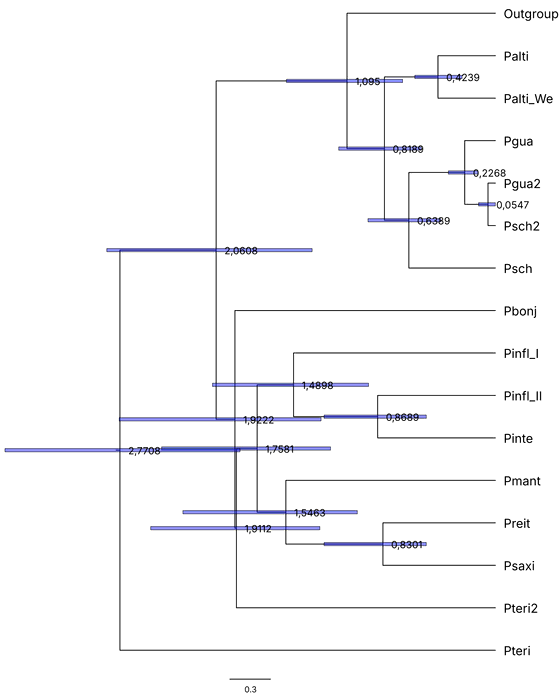
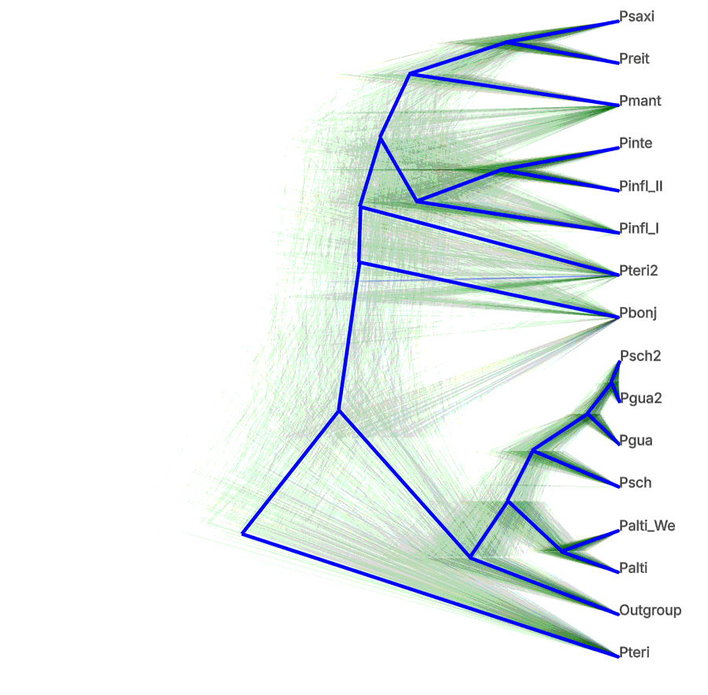

# 04 — SNAPP: species tree and divergence times

Estimate a **species tree with divergence times** from SNPs with SNAPP
(BEAST 2), calibrated with a known age, and summarise it with
TreeAnnotator and DensiTree.

Original tutorial (Michael Matschiner), followed in the original analysis:
<https://github.com/mmatschiner/tutorials/blob/master/divergence_time_estimation_with_snp_data/README.md>

## Install

On the server:

```bash
conda create -n snapp beast2 ruby bcftools
conda activate snapp
packagemanager -add SNAPP          # installs the SNAPP package of BEAST 2
mkdir -p ~/programs && cd ~/programs
git clone https://github.com/mmatschiner/snapp_prep.git     # snapp_prep.rb
```

BEAST 2 can also be downloaded from <https://www.beast2.org/> (as in the
original analysis); then install SNAPP with `~/programs/beast/bin/packagemanager -add SNAPP`.

On your computer, to check and draw the results: **Tracer**
(<https://github.com/beast-dev/tracer/releases>), **FigTree**
(<https://github.com/rambaut/figtree/releases>) and **DensiTree** (comes
with BEAST 2).

## Prepare the folder

```
04_snapp/
├── data/      my_data-out-miss0.9-maf0.01-th100.recode.vcf  (from 03_filtering, with outgroup)
│              samples_snapp.txt     (individuals for SNAPP)
│              popfile.txt           (species of each individual)
│              constraint.txt        (calibration)
└── results/
```

---

## 1. Background

SNAPP estimates the species tree under the **multispecies coalescent**,
directly from biallelic SNPs, without inferring gene trees: it integrates
over all possible gene trees. With a **calibration** (a known age for one
node, e.g. from a dated phylogeny), the branch lengths are in time units,
and you get **divergence times** with their uncertainty.

The price is speed: SNAPP is slow, and the time grows quickly with the
number of individuals. In practice it is run with **a few individuals per
species or population** (2–3) and **~1000 SNPs**.

> **Species tree.** SNAPP assumes that the "species" (the tips) do not
> exchange genes after they split. With gene flow, divergence times are
> underestimated. Define the tips from the structure analyses
> ([05](../../05_pca_dapc/)–[07](../../07_snmf_tess3/)) and the other trees
> ([02](../02_raxml/), [03](../03_svdquartets/)).

## 2. Select the individuals and SNPs

### 2.1 Choose the individuals

Choose **2–3 individuals per species/lineage** (those with the least
missing data), plus **one individual of the outgroup**. Write their IDs in
`data/samples_snapp.txt`, one per line.

> **Example from the original analysis.** A first run with all 135
> individuals was too slow, and a run with each individual as its own tip
> lost almost all SNPs (only SNPs with data in every tip can be used: 306
> of 5,595). The final run used **32 individuals (2 per lineage)** and the
> lineages defined by the SVDQuartets tree.

### 2.2 Make the VCF

Keep the selected individuals, and remove SNPs that are monomorphic in this
subset (`AC==0 || AC==AN`) or that have more than 10% missing data
(`F_MISSING > 0.10`):

```bash
conda activate snapp
cd ~/my_project/phylogenomics/04_snapp
bcftools view -S data/samples_snapp.txt data/my_data-out-miss0.9-maf0.01-th100.recode.vcf \
    -o data/my_data_snapp_subset.vcf
bcftools view -e 'AC==0 || AC==AN || F_MISSING > 0.10' data/my_data_snapp_subset.vcf \
    -o data/my_data_snapp.vcf
grep -vc "^#" data/my_data_snapp.vcf          # number of SNPs left
```

```
2407
```

(Example from the original analysis: 32 individuals.)

## 3. Input files for snapp_prep.rb

### 3.1 Species file

`data/popfile.txt`: two columns separated by a tab, **with the header
`species sample`**: the species (tip of the tree) and the sample ID, as in
the VCF:

```
species	sample
Preit	3005842
Preit	3006949
Psaxi	3005889
Psaxi	3005901
...
Outgroup	2062159
```

The species names must not contain spaces.

### 3.2 Calibration (constraint file)

`data/constraint.txt`: one line with the **calibration**: a prior
distribution for the age of a node, the type of age and the list of species
in that clade (tab-separated):

```
lognormal(0,2.85,0.16)	crown	Outgroup,Preit,Psaxi,Pgua,Pgua2,Psch2,Psch,Pteri,Pteri2
```

- `lognormal(0,2.85,0.16)`: lognormal distribution with offset 0, **mean
  2.85** (in real space, here million years) and standard deviation 0.16
  (in log space). In the original analysis, the age of the split between the
  short- and long-corolla-tube clades of *Petunia* from a dated phylogeny
  (Särkinen et al. 2013).
- `crown`: the calibration is on the crown age of the clade (the age of
  its first split).
- The list: all species of the clade. Here the clade is the whole tree
  (all species, including the outgroup), so the calibration is on the root.

Use a calibration from a dated phylogeny of your group, and explain it in
the methods.

### 3.3 Make the XML file

```bash
ruby ~/programs/snapp_prep/snapp_prep.rb -v data/my_data_snapp.vcf -t data/popfile.txt \
    -c data/constraint.txt -m 1000 -l 100000 -x results/snapp.xml -o snapp
```

- `-m 1000`: use at most 1000 SNPs (randomly chosen).
- `-l 100000`: length of the MCMC chain (number of iterations).
- `-x`: name of the XML file; `-o`: prefix of the output files of SNAPP
  (`snapp.log`, `snapp.trees`). They are written in the folder where BEAST
  runs (here `results/`).

```
WARNING: Excluded 328 sites with only missing data in one or more species.
INFO: Retained 1000 bi-allelic sites.
WARNING: As no starting tree has been specified, a random starting tree will be used by SNAPP...
Wrote SNAPP input in XML format to file results/snapp.xml.
```

The first warning is normal: SNPs without data for all individuals of a
species cannot be used.

**Starting tree.** If BEAST stops with `Could not find a proper state to
initialise`, give a starting tree that agrees with the calibration, e.g.
the SVDQuartets tree ([03](../03_svdquartets/)) with the species as tips:
`--starting-tree my_species_tree.nwk`.

## 4. Run SNAPP

```bash
byobu
conda activate snapp
cd ~/my_project/phylogenomics/04_snapp/results
beast -threads 20 snapp.xml
```

With 1000 SNPs and ~15 species, 100,000 iterations take hours to days.
Run a short test first (e.g. `-l 1000` in `snapp_prep.rb`) to check that
it starts.

Output: `snapp.log` (parameters along the chain) and `snapp.trees` (the
sampled trees).

## 5. Check the run: Tracer

Open `snapp.log` in **Tracer**:

- The **ESS** (effective sample size) of all parameters should be
  **> 200**. Values in red/yellow mean the chain is too short: run longer
  (larger `-l`), or run a second chain and combine them.
- The trace of the posterior should look like a "hairy caterpillar",
  without a trend. Remove the first part (burn-in, usually 10%).

## 6. Summarise the trees

### 6.1 Maximum clade credibility tree

```bash
treeannotator -burnin 10 -height mean snapp.trees snapp.tre
```

`-burnin 10`: discard the first 10% of the trees; `-height mean`: node
ages = mean of the sampled ages. (In older BEAST versions the options
were `-heights mean`.)

Open `snapp.tre` in **FigTree**:

- **Node labels → posterior**: support of each node (≥ 0.95 = well
  supported).
- **Node bars → height_95%_HPD**: the 95% interval of each divergence time.
- **Scale axis**: time scale (in the units of the calibration, e.g.
  million years).



*Example: SNAPP maximum clade credibility tree, with node ages and their 95% HPD (blue bars).*

### 6.2 DensiTree

```bash
densitree snapp.trees        # or open DensiTree from BEAST 2 and load the file
```

DensiTree draws all the sampled trees on top of each other: where they
agree, the lines are sharp; where they disagree (uncertain topology or
times), the lines spread out. It shows the uncertainty much better than a
single tree.



*Example: DensiTree of the posterior trees (green) with the consensus tree (blue). Fuzzy areas show uncertainty in the topology.*

## 7. Interpretation and pitfalls

- **Outgroup inside the ingroup.** In one of the original runs, the
  outgroup (*P. axillaris*) was placed inside the tree, with little
  differentiation between the species. Possible causes: too few SNPs, too
  little information to separate closely related species, or a
  calibration that does not fit. Try a starting tree, more SNPs, or fewer
  and better-defined species.
- **Topology.** Compare the SNAPP tree with SVDQuartets and RAxML-ng
  ([02](../02_raxml/), [03](../03_svdquartets/)). Nodes with low posterior
  and much spread in DensiTree are uncertain.
- **Divergence times** are only as good as the calibration, and gene flow
  makes them younger.
- **Model fit.** The P2C2M.SNAPP R package tests whether the data fit the
  multispecies coalescent model of SNAPP (posterior predictive checks); it
  was tried in the original analysis.

## Next step

Hybridization and introgression: [05_ancestry_painting](../05_ancestry_painting/).

## More information

- Divergence-time estimation with SNP data (Michael Matschiner), the
  tutorial followed here: <https://github.com/mmatschiner/tutorials/blob/master/divergence_time_estimation_with_snp_data/README.md>
- snapp_prep (options of the script): <https://github.com/mmatschiner/snapp_prep>
- BEAST 2 and its tools: <https://www.beast2.org/>
- P2C2M.SNAPP: <https://github.com/P2C2M/P2C2M_SNAPP>

## References

- Bryant D, Bouckaert R, Felsenstein J, Rosenberg NA, RoyChoudhury A (2012)
  Inferring species trees directly from biallelic genetic markers:
  bypassing gene trees in a full coalescent analysis. *Molecular Biology and
  Evolution* 29: 1917–1932.
- Stange M, Sánchez-Villagra MR, Salzburger W, Matschiner M (2018) Bayesian
  divergence-time estimation with genome-wide single-nucleotide
  polymorphism data of sea catfishes (Ariidae) supports Miocene closure of
  the Panamanian Isthmus. *Systematic Biology* 67: 681–699. (snapp_prep.rb)
- Bouckaert R, Vaughan TG, Barido-Sottani J, et al. (2019) BEAST 2.5: an
  advanced software platform for Bayesian evolutionary analysis. *PLoS
  Computational Biology* 15: e1006650.
- Rambaut A, Drummond AJ, Xie D, Baele G, Suchard MA (2018) Posterior
  summarization in Bayesian phylogenetics using Tracer 1.7. *Systematic
  Biology* 67: 901–904.
- Särkinen T, Bohs L, Olmstead RG, Knapp S (2013) A phylogenetic framework
  for evolutionary study of the nightshades (Solanaceae): a dated 1000-tip
  tree. *BMC Evolutionary Biology* 13: 214.
- Duckett DJ, Pelletier TA, Carstens BC (2020) Identifying model violations
  under the multispecies coalescent model using P2C2M.SNAPP. *PeerJ* 8: e8271.
