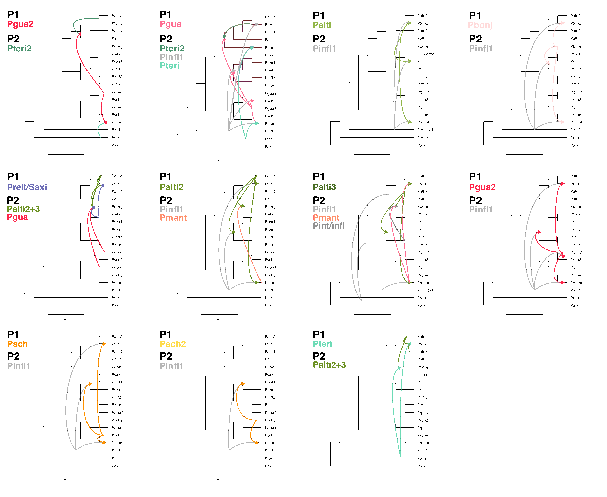

# 07 — HyDe: hybridization detection with phylogenetic invariants

Test, for each trio of populations, whether one of them (the **hybrid**) is
a mix of the other two (the **parents**), and estimate the proportion of
the genome inherited from each parent (γ). Then test each individual of
the putative hybrid populations.

HyDe documentation: <https://hybridization-detection.readthedocs.io/>
HyDe on GitHub: <https://github.com/pblischak/HyDe>

**Scripts**

| Script | What it does |
|---|---|
| [`scripts/summarize_hyde.py`](scripts/summarize_hyde.py) | Sorts the significant triples, counts how often each population is the hybrid, and summarizes the individual tests |

## Install

```bash
conda create -n hyde -c conda-forge python=3.11 cython numpy pandas scipy matplotlib seaborn multiprocess cxx-compiler pip
conda activate hyde
pip install phyde
run_hyde.py -h          # shows the help
```

You will also need `vcf2phylip.py` (installed in [01_splitstree](../01_splitstree/#install)).

> A `DeprecationWarning: pkg_resources is deprecated` message when you run
> the scripts can be ignored.

## Prepare the folder

```
07_hyde/
├── data/      my_data-out-miss0.9-maf0.01-th100.recode.vcf  (with outgroup, from 03_filtering)
│              popmap.txt
├── scripts/   summarize_hyde.py
└── results/
```

---

## 1. Background

HyDe tests a **triple** of populations, P1, Hybrid and P2, plus an
outgroup. Under the coalescent model with hybridization, the hybrid
population is a mix of the two parents:

> Hybrid = γ × P1 + (1 − γ) × P2

HyDe counts the site patterns (e.g. AABB, ABAB, ABBA) of the four taxa and
compares them with the patterns expected without hybridization (the
phylogenetic invariants). For each triple it gives:

| Column | Meaning |
|---|---|
| `Zscore`, `Pvalue` | Test of hybridization. High Z = strong evidence |
| `Gamma` (γ) | Proportion of the hybrid genome from P1 (1 − γ from P2) |
| `AAAA` … `ABCD` | Counts of each site pattern |

How to read γ:

- **γ ≈ 0.5**: the hybrid has about half of its genome from each parent
  (as in hybrid speciation, or an F1-like mix).
- **γ close to 0 or 1**: a small amount of introgression from one parent
  into a population that is mostly the other.
- **γ < 0 or > 1**: not a valid estimate; the test is not meaningful for
  that triple.

`run_hyde.py` tests **all triples in all directions**: with *t* taxa
(including the outgroup) there are 3 × C(t − 1, 3) tests. With 17 taxa
→ 1,680 triples.

## 2. Input files

### 2.1 PHYLIP alignment

HyDe needs a **sequential PHYLIP** file: one line per individual, with the
name and the sequence separated by spaces or a tab. Use the VCF **with the
outgroup**:

```bash
cd data
python ~/programs/vcf2phylip/vcf2phylip.py -i my_data-out-miss0.9-maf0.01-th100.recode.vcf
head -1 my_data-out-miss0.9-maf0.01-th100.recode.min4.phy
```

The first line gives the number of individuals and of sites, e.g.
`132   13265`: you need both numbers for HyDe.

> **Alternative:** in the original analysis the PHYLIP file was made with
> PGDSpider (VCF → PHYLIP), as in
> [06_structure](../../06_structure/#22-option-b-pgdspider). Both work. With
> `vcf2phylip.py` the heterozygous sites are IUPAC codes; with PGDSpider
> they may be written as missing (`?`), depending on the settings.

### 2.2 Map file

Two columns, `<sample ID> <tab> <taxon>`: the **inverse** of the popmap
(`<population> <tab> <sample ID>`). All the outgroup samples must have the
**same taxon name**, because HyDe accepts only one outgroup:

```bash
awk -v OFS='\t' '{pop=$1; if (pop ~ /^Outgroup/) pop="Outgroup"; print $2, pop}' popmap.txt > hyde_map.txt
head -3 hyde_map.txt
cut -f2 hyde_map.txt | sort -u | wc -l     # number of taxa (-t), including the outgroup
```

Check that:

- the sample IDs are exactly the same as in the PHYLIP file;
- the file has no Windows line endings (`dos2unix hyde_map.txt`; see
  [00_setup](../../00_setup/#21-files-used-in-many-tutorials));
- all the individuals of the PHYLIP file are in the map.

## 3. Test all triples: `run_hyde.py`

```bash
cd ../results
run_hyde.py -i ../data/my_data-out-miss0.9-maf0.01-th100.recode.min4.phy \
    -m ../data/hyde_map.txt -o Outgroup -n 132 -t 17 -s 13265
```

| Option | Meaning |
|---|---|
| `-i` | PHYLIP file |
| `-m` | map file |
| `-o` | name of the outgroup taxon (in the map) |
| `-n` | number of individuals (first number of the PHYLIP header) |
| `-t` | number of taxa, **including** the outgroup |
| `-s` | number of sites (second number of the PHYLIP header) |
| `--prefix` | output prefix (default `hyde`) |
| `-p` | p-value cutoff (default 0.05) |

Screen output (original analysis):

```
Reading input file....................Done.
Reading map file  ....................Done.

Analyzing 1680 triple(s).
```

Two output files:

| File | Content |
|---|---|
| `hyde-out.txt` | all triples |
| `hyde-out-filtered.txt` | only the significant triples: p-value < 0.05 / number of triples (Bonferroni correction), and 0 < γ < 1 |

For many triples, use the multithreaded version: `run_hyde_mp.py` with the
same options plus `-j <number of threads>`.

## 4. Test the individuals: `individual_hyde.py`

A population can come out as a hybrid because **all** its individuals are
admixed, or because only **a few** of them are (recent hybrids). To find
out, test each individual of the hybrid populations, using the significant
triples as the list of hypotheses (`-tr`):

```bash
individual_hyde.py -tr hyde-out-filtered.txt \
    -i ../data/my_data-out-miss0.9-maf0.01-th100.recode.min4.phy \
    -m ../data/hyde_map.txt -o Outgroup -n 132 -t 17 -s 13265
```

→ `hyde-ind.txt`: the same columns, with the individual ID in the `Hybrid`
column.

> `bootstrap_hyde.py` (same options, plus `-r` replicates) resamples the
> individuals of the hybrid population. The authors recommend it when
> there are too few sites to test single individuals (less than about
> 10,000 sites); otherwise use `individual_hyde.py`.

## 5. Summarize

```bash
python3 ../scripts/summarize_hyde.py hyde-out-filtered.txt hyde-ind.txt ../data/hyde_map.txt > hyde_summary.txt
less hyde_summary.txt
```

The script prints:

1. the significant triples sorted by Z-score;
2. in how many significant triples each population is the hybrid;
3. for each triple, how many individuals of the hybrid population are
   significant (Bonferroni over all the individual tests, and 0 < γ < 1),
   and their mean γ.

Example (original analysis, 132 individuals, 13,265 SNPs, 17 taxa; 70 of
the 1,680 triples were significant):

```
P1        Hybrid  P2      Zscore  Pvalue    Gamma
Palti_we  Pteri2  Pinfl1  7.24    2.23e-13  0.503
Pgua      Pmant   Pinfl1  6.50    4.05e-11  0.474
Pgua2     Pmant   Pinfl1  6.38    9.15e-11  0.478
Palti_W   Pteri2  Pinfl1  6.16    3.68e-10  0.469
...
## Number of significant triples per hybrid population
Pbonj   17
Pteri2  12
Pmant   10
...
## Individuals
P1      Hybrid_pop  P2       significant/total  mean_gamma_significant
Preit   Pbonj       Pgua     10/10              0.514
Pgua    Preit       Pinfl1   9/12               0.545
Psch2   Preit       Pinfl1   3/12               0.400
```

- `Preit / Pbonj / Pgua`: all 10 individuals of Pbonj are significant, with
  similar γ → the signal is shared by the whole population (old admixture).
- `Psch2 / Preit / Pinfl1`: only 3 of 12 → the signal comes from a few
  individuals, or this triple is weaker.



*Example: the significant HyDe triples drawn on the species tree (one panel per hybrid population: the hybrid in the middle, P1 and P2 in colour). Figure from the original analysis, edited by hand.*

## 6. Interpretation

- **Many triples, one event.** Gene flow into an ancestral population makes
  all of its descendants look like hybrids, and a hybrid population
  makes many triples significant (with different P1 and P2 from the same
  clades). Look for the patterns: which population is the hybrid in most
  triples, and which clades are the parents.
- **The same trio in two directions.** If A is significant as the hybrid of
  B and C and B is also significant as the hybrid of A and C, the signal is
  between A and B but the direction is not clear.
- **HyDe assumes** that the only reticulation is the one being tested, and
  that the parents are not themselves admixed. With a lot of gene flow in
  the group, some significant triples are side effects of other events.
- **Compare with the other methods.** A result supported by Dsuite
  ([06](../06_dsuite/)), Dfoil ([08](../08_dfoil/)), ADMIXTOOLS
  ([09](../09_admixtools/)) and SNaQ ([10](../10_snaq/)) is much more
  convincing than a result from one method alone.
- Check if the putative hybrid individuals are heterozygous at the sites
  fixed between the parents with [ancestry painting](../05_ancestry_painting/)
  (recent hybrids).

## Next step

[08 — Dfoil](../08_dfoil/): direction of introgression in five-taxon
trees.

## References

- Blischak PD, Chifman J, Wolfe AD, Kubatko LS (2018) HyDe: a Python
  package for genome-scale hybridization detection. *Systematic Biology*
  67: 821–829.
- Kubatko LS, Chifman J (2019) An invariants-based method for efficient
  identification of hybrid species from large-scale genomic data. *BMC
  Evolutionary Biology* 19: 112.
