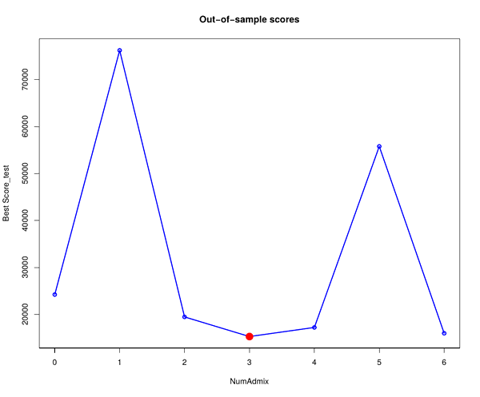
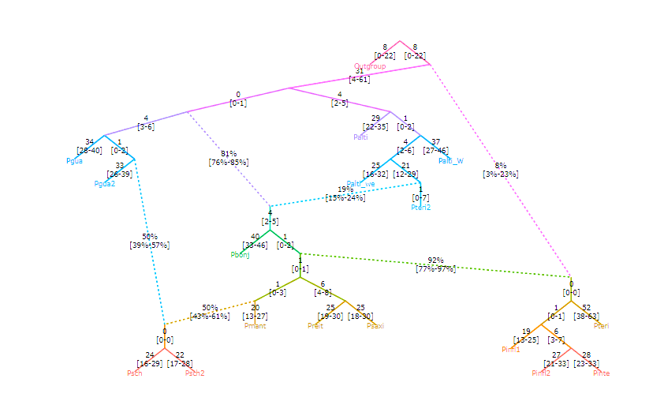

# 09 — ADMIXTOOLS 2: admixture graphs

Find the **admixture graph** (a population tree with admixture edges) that
best explains the f-statistics between populations, with the R package
ADMIXTOOLS 2. The graphs are searched automatically with `find_graphs` for
0, 1, 2, ... admixture events, many times, and the best number of events
is chosen with an **out-of-sample** score.

ADMIXTOOLS 2: <https://uqrmaie1.github.io/admixtools/>
Tutorial: <https://uqrmaie1.github.io/admixtools/articles/admixtools.html>
Graph search: <https://uqrmaie1.github.io/admixtools/articles/graphs.html>

**Scripts**

| Script | What it does |
|---|---|
| [`scripts/run_find_graphs.R`](scripts/run_find_graphs.R) | Runs `find_graphs` many times for each number of admixture events, in parallel, and saves the best graph of each run |

The other steps are run in RStudio (section 4 onwards).

## Install

On the server (for the long runs):

```bash
conda create -n admixtools -c conda-forge -c bioconda r-base=4.4 r-tidyverse r-igraph r-plotly \
    r-rcpp r-rcpparmadillo r-remotes r-dosnow r-foreach r-doparallel r-furrr r-future r-abind \
    r-data.tree r-lobstr r-parallelly r-quadprog r-pgenlibr r-cubelyr r-htmlwidgets plink2
conda activate admixtools
R
```

In R:

```r
remotes::install_github("uqrmaie1/admixtools", upgrade = "never")
library(admixtools)
```

On your computer (RStudio), for the plots:

```r
install.packages(c("remotes", "tidyverse", "igraph", "plotly", "htmlwidgets"))
remotes::install_github("uqrmaie1/admixtools", dependencies = TRUE)
```

> If the installation fails because of a package, install that package
> first with `install.packages()` (or conda on the server) and try again.
> In the original analysis some packages had to be reinstalled before it
> worked.

## Prepare the folder

```
09_admixtools/
├── data/      my_data-out-miss0.9-maf0.01-th100.recode.vcf  (with outgroup, from 03_filtering)
│              popmap.txt
├── scripts/   run_find_graphs.R
└── results/
```

---

## 1. Background

**f-statistics** measure shared genetic drift between populations:

- **f2(A, B)**: drift between A and B (genetic distance);
- **f3(C; A, B)**: negative if C is a mix of populations related to A and B;
- **f4(A, B; C, D)**: different from 0 if the tree ((A,B),(C,D)) is not
  enough (the D statistic of [06_dsuite](../06_dsuite/) is a normalized f4).

An **admixture graph** predicts all these statistics. ADMIXTOOLS 2
calculates the f2 statistics once, and then compares graphs with them:

| Term | Meaning |
|---|---|
| `score` | fit of the graph to the f-statistics: **lower is better** |
| `numadmix` | number of admixture events (admixture edges) in the graph |
| `find_graphs` | heuristic search for the best graph with a given numadmix. It is random: each run can find a different graph, so it is run many times |
| out-of-sample score (`score_test`) | the graph is fitted on half of the data (SNP blocks) and scored on the other half. Unlike `score`, it does not always improve with more admixture events |

## 2. PLINK files

Convert the VCF to PLINK (`.bed`, `.bim`, `.fam`):

```bash
cd results
plink2 --vcf ../data/my_data-out-miss0.9-maf0.01-th100.recode.vcf \
    --allow-extra-chr --double-id --vcf-half-call missing \
    --set-missing-var-ids @:# --make-bed --out my_data
```

ADMIXTOOLS reads the **population** of each individual from the **first
column of the `.fam` file**. After plink2 it has the sample ID; replace it
with the population from the popmap:

```bash
awk 'NR==FNR {pop[$2]=$1; next} {$1=pop[$2]; print}' OFS='\t' ../data/popmap.txt my_data.fam > tmp.fam
mv tmp.fam my_data.fam
cut -f1 my_data.fam | sort | uniq -c       # individuals per population
```

```
Preit	3005842	0	0	0	-9
Preit	3005924	0	0	0	-9
```

All the outgroup individuals must have the same population name (e.g.
`Outgroup`). In the original analysis the populations were added to the
`.fam` file by hand.

## 3. f2 statistics

In R (on the server, or in RStudio on your computer):

```r
library(admixtools)
library(tidyverse)
setwd("~/project/phylogenomics/09_admixtools/results")

prefix    <- "my_data"
my_f2_dir <- "f2_my_data"
extract_f2(prefix, my_f2_dir, auto_only = FALSE)
f2_blocks <- f2_from_precomp(my_f2_dir, afprod = TRUE)
dim(f2_blocks)
```

`auto_only = FALSE` keeps all chromosomes/scaffolds (by default only the
human autosomes 1–22 would be kept). Screen output (original analysis):

```
ℹ highland-axi-132-mss9-maf1-th100.neutral.bed has 132 samples and 13265 SNPs
ℹ Calculating allele frequencies from 132 samples in 17 populations
✔ 13265 SNPs read in total
! 8139 SNPs remain after filtering. 8139 are polymorphic.
Warning messages:
1: In get_block_lengths(...) :
  No genetic linkage map found! Defining blocks by base pair distance of 2e+06
```

- Only SNPs without missing data in any **population** are kept (8,139 of
  13,265 here).
- The warning is normal: without a genetic map, the SNPs are grouped into
  blocks of 2 Mb for the jackknife/bootstrap. `dim(f2_blocks)` gives
  populations × populations × **number of blocks**.
- **Data without a reference genome** (de novo loci): each locus is its own
  "chromosome" and becomes one block, so there can be thousands of tiny
  blocks and the analyses are very slow. Check the number of blocks.

## 4. Search for graphs (server)

`find_graphs` is run, for each numadmix (0 to 6), **100 times**, keeping
the best graph of each run. Edit the settings at the top of
`scripts/run_find_graphs.R`:

```r
my_f2_dir    <- "f2_my_data"
outpop       <- "Outgroup"
numadmix_all <- 0:6
replicates   <- 1:100
stop_gen2    <- 1000
numgraphs    <- 100
cores        <- 12
```

and run it inside byobu:

```bash
conda activate admixtools
cd results
Rscript ../scripts/run_find_graphs.R
```

→ one file per run, `winner.<replicate>m<numadmix>.rds` (e.g.
`winner.52m3.rds`). If it stops, run it again: the runs already done are
skipped.

| Option of `find_graphs` | Meaning |
|---|---|
| `outpop` | outgroup population: the graphs are rooted with it |
| `numadmix` | number of admixture events |
| `stop_gen2` | maximum number of generations (iterations) of the search |
| `numgraphs` | number of graphs evaluated in each generation |
| `plusminus_generations` | the search stops if the score does not improve for this many generations |

A single run in R, as in the first tests of the original analysis:

```r
high.1m3   <- find_graphs(my_f2_dir, outpop = "Outgroup", numadmix = 3,
                          stop_gen2 = 1000, numgraphs = 100,
                          plusminus_generations = 20, verbose = TRUE)
winner.1m3 <- high.1m3 %>% slice_min(score, with_ties = FALSE)
winner.1m3$score
plot_graph(winner.1m3$edges[[1]], textsize = 4)
```

## 5. Compare the runs (RStudio)

Copy the `winner.*.rds` files and the `f2_my_data/` folder to your computer
and run step by step.

**5.1 Scores of all runs**

```r
library(admixtools)
library(tidyverse)
setwd("C:/project/09_admixtools/results")

files  <- list.files(pattern = "^winner\\.[0-9]+m[0-9]+\\.rds$")
scores <- tibble(file = files) %>%
  mutate(replicate = as.numeric(sub("winner\\.(\\d+)m\\d+\\.rds", "\\1", file)),
         numadmix  = as.numeric(sub("winner\\.\\d+m(\\d+)\\.rds", "\\1", file)),
         score     = map_dbl(file, ~ readRDS(.x)$score))
write_csv(scores, "scores_table.csv")

# best run for each number of admixture events
best <- scores %>% group_by(numadmix) %>% slice_min(score, with_ties = FALSE) %>% ungroup()
best

ggplot(scores, aes(x = factor(numadmix), y = score)) + geom_boxplot() +
  geom_point(data = best, colour = "red", size = 3) +
  xlab("number of admixture events") + ylab("score (lower is better)")
```

The boxplots show how much the runs vary: if many runs reach the same
best score, the search is reliable. The best score always decreases with
more admixture events, so it cannot be used alone to choose numadmix.

Original analysis (best of 100 runs):

| numadmix | best run | score |
|---|---|---|
| 0 | 59 | 6236.7 |
| 1 | 84 | 5252.5 |
| 2 | 20 | 4581.1 |
| 3 | 52 | 3411.9 |
| 4 | 7 | 2892.2 |
| 5 | 31 | 2218.8 |
| 6 | 62 | 1835.1 |

**5.2 Out-of-sample score: how many admixture events?**

```r
f2_blocks <- f2_from_precomp("f2_my_data", afprod = TRUE)
nblocks   <- dim(f2_blocks)[3]
set.seed(123)
train     <- sample(1:nblocks, round(nblocks / 2))   # half of the blocks to fit the graph

best$score_test <- map_dbl(best$file, function(f) {
  graph <- readRDS(f)$edges[[1]]
  qpgraph(data = f2_blocks[, , train], graph,
          f2_blocks_test = f2_blocks[, , -train])$score_test
})
best

plot(best$numadmix, best$score_test, type = "o", col = "blue", lwd = 2,
     xlab = "NumAdmix", ylab = "Best score_test", main = "Out-of-sample scores")
min_i <- which.min(best$score_test)
points(best$numadmix[min_i], best$score_test[min_i], col = "red", pch = 19, cex = 2)
```

Choose the numadmix with the **lowest out-of-sample score**: more
admixture events than that fit the noise of the data.



*Example: out-of-sample scores of the best graph of each numadmix (original analysis). The lowest is at 3 admixture events.*

**5.3 Compare two graphs**

To test if one graph fits significantly better than another (e.g. the best
graphs with 2 and 3 events):

```r
g2 <- readRDS(best$file[best$numadmix == 2])$edges[[1]]
g3 <- readRDS(best$file[best$numadmix == 3])$edges[[1]]
fits <- qpgraph_resample_multi(f2_blocks, list(g2, g3), nboot = 1000)
compare_fits(fits[[1]]$score_test, fits[[2]]$score_test)
```

`diff` is the difference in score (graph 1 − graph 2) and `p` its
p-value: p < 0.05 → the graphs fit differently; p > 0.05 → the data cannot
tell them apart (choose the simpler one).

## 6. The best graph with confidence intervals

```r
graph <- readRDS(best$file[best$numadmix == 3])$edges[[1]]
plot_graph(graph, textsize = 4)

# bootstrap over SNP blocks: confidence intervals of the drift lengths and admixture weights
boot <- qpgraph_resample_snps(f2_blocks, graph, boot = 1000)
ci   <- boot %>% summarize_fits()
p    <- plotly_graph(ci, print_highlow = TRUE)   # interactive, with [low-high] intervals
p
htmlwidgets::saveWidget(p, "best_graph_CI.html")
```

- `plot_graph()` draws a static graph (save it with `ggsave("best_graph.pdf")`).
- `plotly_graph()` draws an interactive graph; with
  `print_highlow = TRUE` it writes the confidence intervals of each value.
  Open the HTML file in a browser; the camera icon saves it as PNG.
- Numbers on the dotted edges = admixture proportions (%); on the other
  edges = drift lengths (× 1000).



*Example: best admixture graph with 3 admixture events (original analysis), with the bootstrap intervals in brackets.*

## 7. Interpretation

- **Many graphs fit equally well.** With several admixture events, graphs
  with different topologies can have almost the same score. Look at the
  features that the best graphs of different runs **share**, and compare
  them with `qpgraph_resample_multi`. In a test with simulated data and
  short runs, the best graph had the right number of events but not the
  simulated topology: short runs and few replicates are not enough.
- An admixture edge from a **deep, unsampled branch** ("ghost") can be
  real (a population not sampled) or a way for the graph to fit noise.
- Admixture weights close to 0% or with intervals reaching 0 are weak.
- Compare with Dsuite ([06](../06_dsuite/)), HyDe ([07](../07_hyde/)) and
  SNaQ ([10](../10_snaq/)).

## Next step

[10 — SNaQ](../10_snaq/): phylogenetic networks from quartet
concordance factors.

## References

- Maier R, Flegontov P, Flegontova O, Işıldak U, Changmai P, Reich D (2023)
  On the limits of fitting complex models of population history to
  f-statistics. *eLife* 12: e85492.
- Patterson N, Moorjani P, Luo Y, et al. (2012) Ancient admixture in human
  history. *Genetics* 192: 1065–1093.
