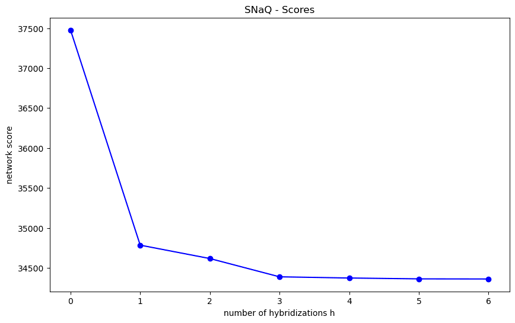
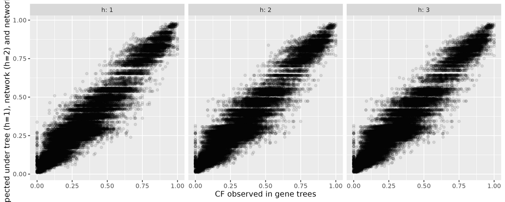
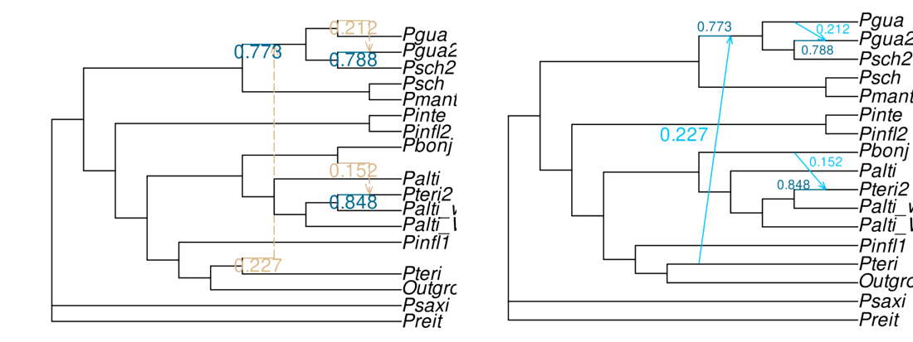

# 10 — SNaQ: phylogenetic networks

Estimate a **species network**: a species tree with extra edges
(hybridizations or gene flow), each with its inheritance proportion (γ).
The quartet concordance factors are calculated from the SNPs with
**SNPs2CF** (R), and the networks are estimated with **SNaQ** (Julia),
from 0 to several hybridizations.

- SNaQ.jl: <https://juliaphylo.github.io/SNaQ.jl/stable/>
- SNaQ tutorial (Solís-Lemus lab): <https://solislemuslab.github.io/snaq-tutorial/>
- SNPs2CF: <https://github.com/melisaolave/SNPs2CF>

**Scripts**

| Script | What it does |
|---|---|
| [`scripts/run_snaq.jl`](scripts/run_snaq.jl) | Runs SNaQ for h = 0, 1, 2, ..., each network starting from the previous one |

> **New versions of the Julia packages.** Since PhyloNetworks v1.0 (2025),
> SNaQ is a separate package, **SNaQ.jl**, and several functions were
> renamed. Old scripts (and the original analysis) used the old names; the
> commands here use the new ones:
>
> | Old (PhyloNetworks ≤ 0.16) | New (PhyloNetworks + SNaQ.jl) |
> |---|---|
> | `readTableCF` | `readtableCF` |
> | `readTopology` | `readnewick` (or `readsnaqnetwork` for `.out` files) |
> | `readMultiTopology` | `readmultinewick` |
> | `topologyQPseudolik!` | `topologyQpseudolik!` |
> | `fittedQuartetCF` | `fittedquartetCF` |
> | `writeTopology` | `writenewick` |
>
> Full list: <https://juliaphylo.github.io/PhyloUtilities/refactoring-v0.16-to-v1-readme.html>

## Install

One conda environment with Julia and R:

```bash
conda create -n snaq -c conda-forge julia r-base r-ggplot2 r-foreach r-domc r-pegas
conda activate snaq
```

The Julia packages (once; it takes a while):

```bash
julia -e 'using Pkg; Pkg.add(["PhyloNetworks", "SNaQ", "PhyloPlots", "RCall", "CSV", "DataFrames"])'
```

SNPs2CF (an R script):

```bash
cd ~/programs
git clone https://github.com/melisaolave/SNPs2CF.git
ls SNPs2CF/functions_v1.7.R
```

> The original analysis used `functions_v1.6.R`; v1.7 adds an option and
> takes the same arguments.

## Prepare the folder

```
10_snaq/
├── data/      PHYLIP file (the same as for HyDe, 07_hyde)
│              imap.txt         (individual → species, see below)
│              start_tree.nwk   (population tree, see below)
├── scripts/   run_snaq.jl
└── results/
```

---

## 1. Background

SNaQ uses **quartet concordance factors (CFs)**: for each set of four
species, the proportion of genes supporting each of the three possible
unrooted trees (AB|CD, AC|BD, AD|BC). Under the multispecies coalescent,
a tree predicts some CFs; gene flow changes them in a way that a network
with a hybrid edge can explain.

SNaQ searches for the network that best fits the observed CFs, for a given
maximum number of hybridizations, **h**. The fit is given as a **score**
(the negative log pseudo-likelihood, `-loglik`): **lower is better**. The
score always improves when h increases, so the best h is where the
improvement **levels off**.

From SNPs, the CFs are calculated by SNPs2CF: each SNP is treated as a
"gene" for each quartet of individuals, and the counts are summarized by
species.

## 2. Input files

**PHYLIP**: the same file as in [07_hyde](../07_hyde/#21-phylip-alignment)
(`vcf2phylip.py`, or PGDSpider as in the original analysis), with the
outgroup.

**Imap**: two columns with a **header** `traits` and `species`,
tab-separated, the individuals first:

```bash
(printf "traits\tspecies\n"; \
 awk -v OFS='\t' '{pop=$1; if (pop ~ /^Outgroup/) pop="Outgroup"; print $2, pop}' popmap.txt) > imap.txt
head -3 imap.txt
```

```
traits	species
3005842	Preit
3005924	Preit
```

> The header is required: without it, SNPs2CF reads the first individual
> as the column names. Check also for Windows line endings (`dos2unix`).

**Starting tree**: a population tree in Newick, with **exactly the species
names of the Imap** as tips, including `Outgroup`. For example, the
SVDQuartets population tree ([03_svdquartets](../03_svdquartets/)) or the
SNAPP tree ([04_snapp](../04_snapp/)). Branch lengths and support values
are not needed:

```
(((((((Preit,Psaxi),(((Pgua,(Pgua2,Psch2)),Psch),Pmant)),((((Pteri2,Palti_we),Palti_W),Palti),Pbonj)),(Pinfl2,Pinte)),Pinfl1),Pteri),Outgroup);
```

## 3. Concordance factors with SNPs2CF (R)

Run in R on the server, inside byobu (it can take days):

```r
source("~/programs/SNPs2CF/functions_v1.7.R")

output <- SNPs2CF(seqMatrix = "../data/my_data.phy",
                  ImapName = "../data/imap.txt",
                  between.sp.only = TRUE,
                  bootstrap = FALSE,
                  n.quartets = 5,
                  outputName = "my_data_CF.csv",
                  save.progress = FALSE,
                  cores = 8)
```

| Option | Meaning |
|---|---|
| `between.sp.only = TRUE` | only quartets with four different species |
| `n.quartets` | number of quartets of **individuals** sampled for each quartet of species. `"all"` uses all combinations |
| `bootstrap` | `TRUE` also calculates the 95% confidence intervals of the CFs (needed for `bootsnaq`); slower |
| `cores` | processors |

With all quartets the original analysis (132 individuals, 17 species)
analysed 6,764,352 quartets and took **3.5 days**. With `n.quartets = 5`
the table had 11,897 quartets and SNaQ ran much faster; the SNaQ results
here come from that table.

The output CSV has one row per quartet: `t1,t2,t3,t4,CF12_34,CF13_24,CF14_23,genes`.
Check the `.err` file: it lists the species quartets that could not be
sampled `n.quartets` times.

## 4. Run SNaQ (Julia)

Edit the settings at the top of `scripts/run_snaq.jl` (CF file, starting
tree, maximum h, processors), then:

```bash
cd results
julia ../scripts/run_snaq.jl
```

The script runs SNaQ for h = 0, 1, 2, ..., each time starting from the best
network of the previous h, with 10 independent runs per h, in parallel
(one run per processor). The original analysis went up to h = 7; each h
took about one day with 12 processors.

Output in `results/snaq/`, for each h:

| File | Content |
|---|---|
| `net<h>.out` | best network (Newick) and its score (`-Ploglik`) |
| `net<h>.networks` | the best network with other directions of the hybrid edges, and their scores |
| `net<h>.log` | log of the runs |

If the server stops the script, start again from the last network: set
`start_net = "snaq/net3.out"` and `hmin = 4`.

The same steps by hand in Julia (as in the original analysis):

```julia
using Distributed
addprocs(12)
@everywhere using PhyloNetworks, SNaQ

cf   = readtableCF("my_data_CF.csv")
tre  = readnewick("../data/start_tree.nwk")
net0 = snaq!(tre,  cf, hmax=0, filename="snaq/net0", seed=123)
net1 = snaq!(net0, cf, hmax=1, filename="snaq/net1", seed=456)
net2 = snaq!(net1, cf, hmax=2, filename="snaq/net2", seed=789)
# ... and so on
```

## 5. Choose the number of hybridizations

Collect the scores:

```bash
for h in 0 1 2 3 4 5 6 7; do
    echo -e "$h\t$(grep -o 'Ploglik = [0-9.]*' snaq/net$h.out | cut -d' ' -f3)"
done > snaq_scores.txt
cat snaq_scores.txt
```

Original analysis:

```
0	37476.37
1	34784.98
2	34617.35
3	34388.75
4	34373.76
5	34362.99
6	34361.62
7	34361.36
```

Plot them (RStudio):

```r
scores <- read.table("snaq_scores.txt", col.names = c("h", "score"))
plot(scores$h, scores$score, type = "b", pch = 19, col = "blue",
     xlab = "number of hybridizations (h)", ylab = "network score (-loglik)")
```



*Example: the score drops a lot from h = 0 to h = 1, a little more until h = 3, and then stays almost flat: h = 3 was chosen.*

## 6. Observed vs expected CFs

How well does each network explain the CFs? In Julia:

```julia
using PhyloNetworks, SNaQ, CSV, DataFrames
cf = readtableCF("my_data_CF.csv")

fits = DataFrame()
for h in 1:3
    net = readsnaqnetwork("snaq/net$h.out")
    topologyQpseudolik!(net, cf)          # expected CFs under this network
    fit = fittedquartetCF(cf, :long)
    fit[!, :h] .= h
    append!(fits, fit)
end
CSV.write("fittedCF_h1-3.csv", fits)
```

Then in RStudio:

```r
library(ggplot2)
fit <- read.csv("fittedCF_h1-3.csv")
ggplot(fit, aes(x = obsCF, y = expCF)) +
  geom_abline(intercept = 0, slope = 1, colour = "grey") +
  geom_point(alpha = 0.1) +
  facet_wrap(~ h, labeller = label_both) +
  xlab("CF observed") + ylab("CF expected under the network") +
  theme_bw()
ggsave("fitted_CFs.png", width = 10, height = 4)
```

The closer the points are to the diagonal, the better the fit.



*Example: observed vs expected CFs for h = 1, 2 and 3.*

## 7. Plot the network

In Julia (PhyloPlots draws through R):

```julia
using PhyloNetworks, SNaQ, PhyloPlots, RCall
net3 = readsnaqnetwork("snaq/net3.out")
rootatnode!(net3, "Outgroup")

R"svg"("best_network_h3.svg", width=8, height=4)
R"par"(mfrow=[1,2], mar=[0,0,0,0])
plot(net3, showgamma=true, minorhybridedgecolor="tan")
plot(net3, style=:majortree, arrowlen=0.07, showgamma=true)
R"dev.off()"
```

- `showgamma=true` writes the inheritance proportions (γ) on the hybrid
  edges.
- `style=:majortree` draws the major tree with the minor hybrid edges as
  arrows.
- If `rootatnode!` gives an error, the outgroup is inside a hybrid cycle in
  this network: SNaQ networks are semi-directed and the root position is
  not estimated. Look at the other networks in `net<h>.networks`.



*Example: the best network with h = 3 (original analysis), as a network (left) and as the major tree with the hybrid edges as arrows (right).*

## 8. Interpretation

- **Hybrid edges vs their direction.** The edges (which lineages are
  connected) are more reliable than the direction and the exact position of
  the hybrid node. In a test with simulated data (gene flow from C into B),
  SNaQ found the B–C edge with γ ≈ 0.47 but placed the hybrid node on C.
  Check the alternatives in `net<h>.networks` and compare with HyDe
  ([07](../07_hyde/)) and Dfoil ([08](../08_dfoil/)).
- **SNaQ assumes level-1 networks** (hybrid cycles do not overlap) and
  that all discordance comes from incomplete lineage sorting and the
  hybrid edges.
- **Small γ** (e.g. < 0.05) on an edge is weak evidence; edges that appear
  in the networks of several values of h are more convincing.
- **Uncertainty**: with `bootstrap = TRUE` in SNPs2CF, the CF confidence
  intervals can be used for a bootstrap of the network with `bootsnaq`
  (see the SNaQ documentation). It takes about 100 × the time of one
  analysis.

## Next step

More tutorials will be added (IQ-TREE with concordance factors, and
species delimitation).

## References

- Solís-Lemus C, Ané C (2016) Inferring phylogenetic networks with maximum
  pseudolikelihood under incomplete lineage sorting. *PLoS Genetics* 12:
  e1005896.
- Solís-Lemus C, Bastide P, Ané C (2017) PhyloNetworks: a package for
  phylogenetic networks. *Molecular Biology and Evolution* 34: 3292–3298.
- Olave M, Meyer A (2020) Implementing large genomic single nucleotide
  polymorphism data sets in phylogenetic network reconstructions: a case
  study of particularly rapid radiations of cichlid fish. *Systematic
  Biology* 69: 848–862.
